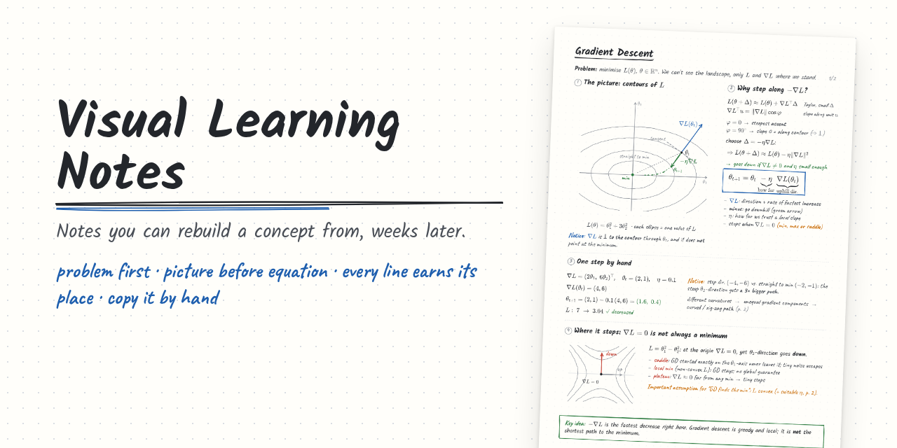
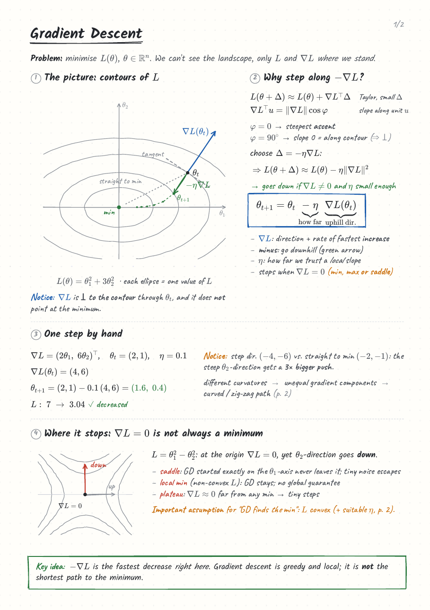
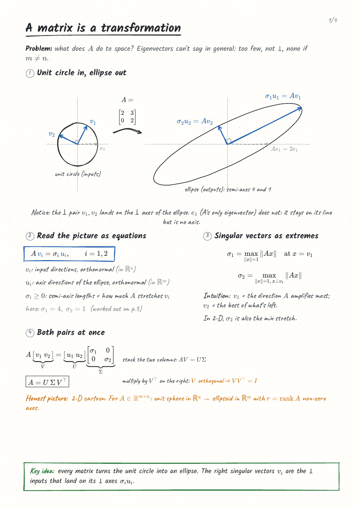
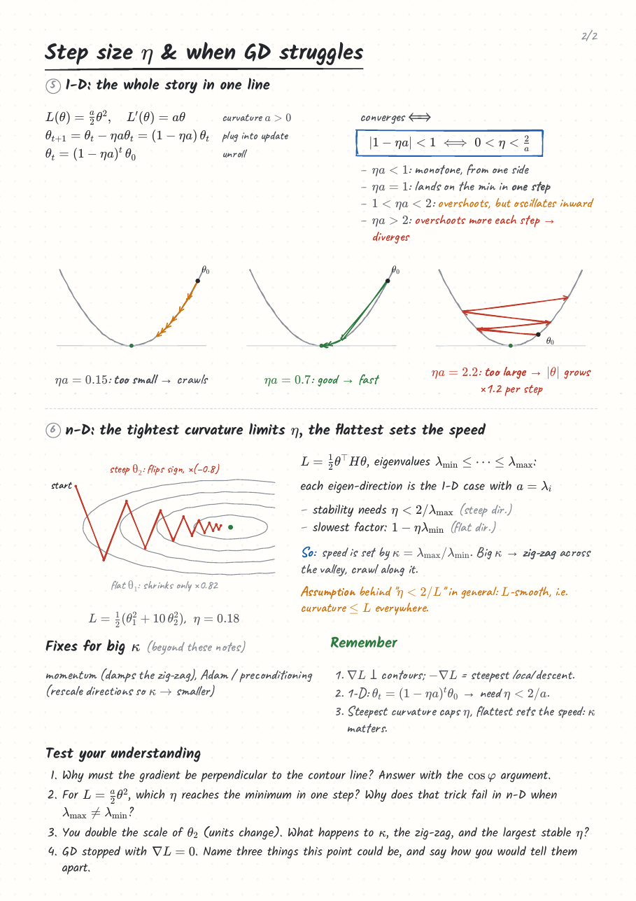
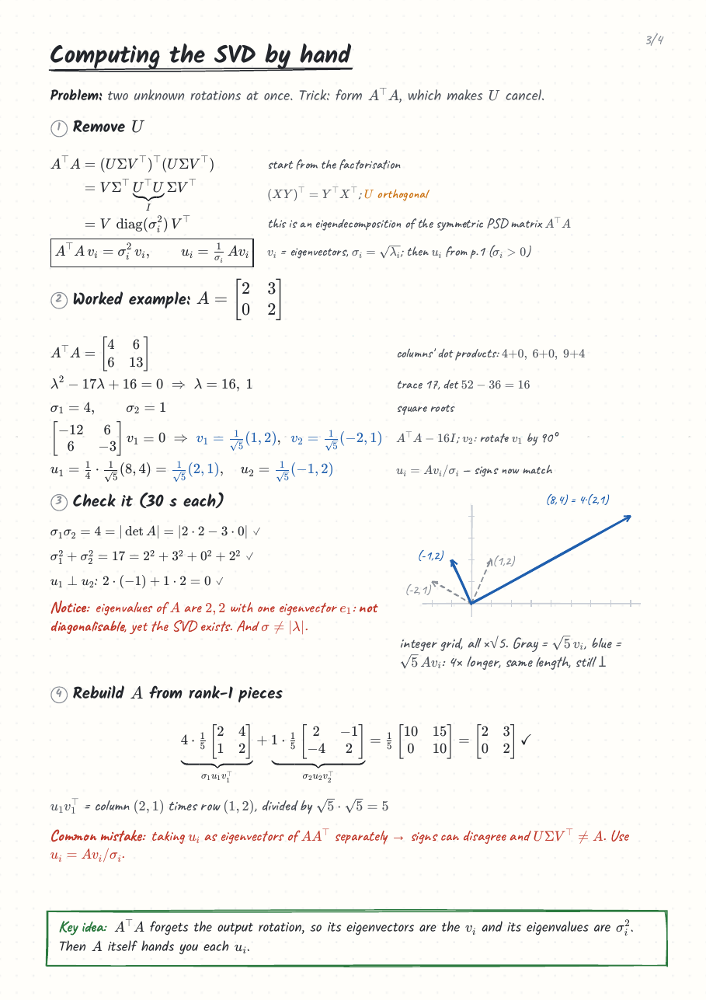
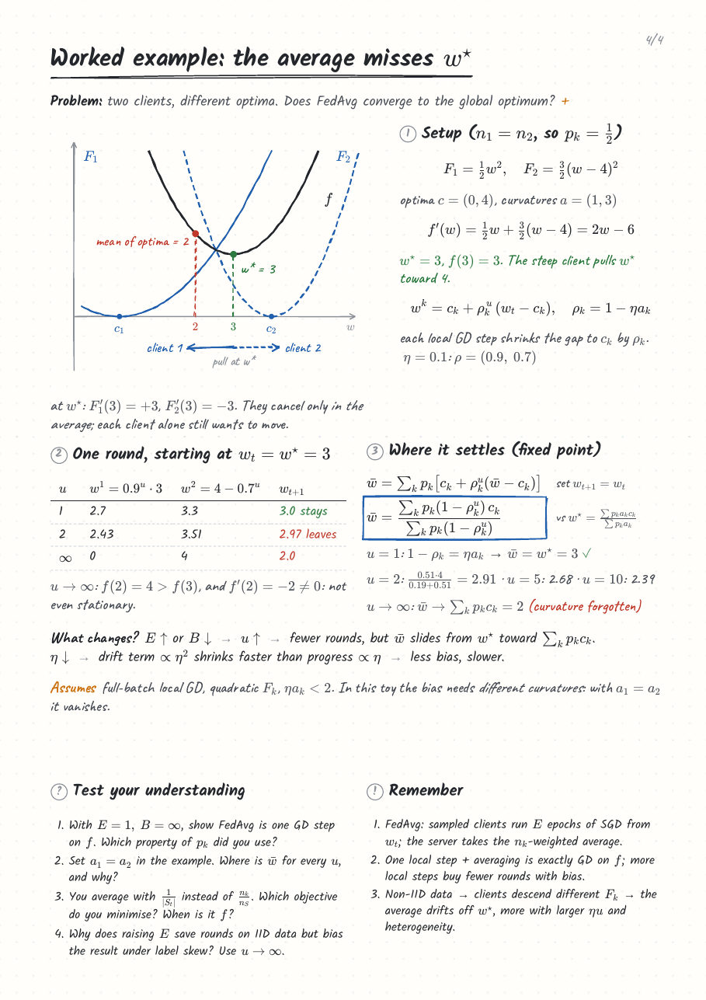

<p align="center">
  
</p>

<p align="center">
  <a href="LICENSE"></a>
  <a href="https://docs.claude.com/en/docs/claude-code/skills"></a>
  
  <a href="https://github.com/mahdi13830510/visual-learning-notes/stargazers"></a>
</p>

<p align="center"><b>Notes you can rebuild a concept from, weeks later.</b><br>
<b>Visual Learning Notes</b> makes Claude take notes like the sharpest student in an excellent lecture: compact, visual, mathematically meaningful, and easy to copy into your own notebook.</p>

<p align="center">
  <a href="https://mahdi13830510.github.io/visual-learning-notes/showcase/gradient-descent/"></a>
  <a href="https://mahdi13830510.github.io/visual-learning-notes/showcase/svd/"></a>
  <br><sub>Real output. Left: gradient descent, page 1. Right: SVD, page 1. Each set comes with a page-by-page handwriting blueprint.</sub>
  <br><a href="https://mahdi13830510.github.io/visual-learning-notes/"><b>▶ Open the notes: live pages, PDFs and blueprints</b></a>
</p>

---

## Notes are not explanations

A textbook spends ten pages on a concept, and a lecture spends an hour. Good notes capture the *intellectual structure* of that explanation on one or two pages: the problem, the picture, the equation that describes the picture, what follows from it, and where it breaks. AI summaries are good at the opposite: paragraphs, definition lists, colourful cards, and walls of equations with no meaning attached.

**Ask for notes on gradient descent and a typical AI answer gives you:**
> *Gradient descent is an iterative optimization algorithm… Key concepts: 1. Learning rate 2. Gradient 3. Convergence…* followed by θ ← θ − η∇L and five bullet points.

**With `visual-learning-notes` you get two pages you can copy in about 45 minutes:**
- the problem in one line: *we can't see the landscape, only L and ∇L where we stand*;
- a contour plot with θₜ, the gradient ⟂ to the contour, the green descent step, and a dotted line showing that the step does **not** aim at the minimum;
- *why* −∇L, in three margin-annotated lines (Taylor, then cos φ, then a guaranteed decrease);
- the update rule with underbraces tied to the picture's arrows;
- one step by hand: θ = (2, 1) → (1.6, 0.4), L: 7 → 3.04;
- the step-size limit *derived*: θₜ = (1 − ηa)ᵗθ₀ ⇒ η < 2/a, drawn as three same-scale panels (crawls, converges, diverges);
- the n-D zig-zag and the condition number, a saddle point, the assumptions;
- four *why / what-if* questions, and three things to remember.

## What you get

| | |
|---|---|
| ✍️ **Handwriting blueprint** | For every page: the layout, what to draw (with sizes, positions and exact labels), the equations, the annotations, the must-not-omit points, and the minutes to copy. Then *Test your understanding* and *Remember*. |
| 📄 **Printable A4 pages** | Ink on dotted paper, hand-drawn diagrams plotted from real coordinates (rough.js), and KaTeX math. Rendered to a vector PDF and checked automatically for overflow, broken math and colliding labels; then Claude looks at every page. |
| 🧩 **Excalidraw diagrams** | Native `.excalidraw` files for architectures, flows and concept maps, verified by Excalidraw's own renderer so they open and stay editable. |

The digital pages complement your handwritten notes; they don't replace them. Writing them by hand is the point.

## Notes it made

<table>
<tr>
<td width="33%" valign="top"><a href="https://mahdi13830510.github.io/visual-learning-notes/showcase/gradient-descent/"></a><br><b><a href="https://mahdi13830510.github.io/visual-learning-notes/showcase/gradient-descent/">Gradient Descent</a></b><br><sub>Why −∇L, one step by hand, η &lt; 2/a derived, the κ zig-zag, saddles. 2 pages · <a href="showcase/gradient-descent/notes.pdf">PDF</a> · <a href="showcase/gradient-descent/blueprint.md">blueprint</a></sub></td>
<td width="33%" valign="top"><a href="https://mahdi13830510.github.io/visual-learning-notes/showcase/svd/"></a><br><b><a href="https://mahdi13830510.github.io/visual-learning-notes/showcase/svd/">Singular Value Decomposition</a></b><br><sub>Circle → ellipse, rotate–stretch–rotate, a 2×2 SVD by hand with 30-second checks, Eckart–Young. 4 pages · <a href="showcase/svd/notes.pdf">PDF</a> · <a href="showcase/svd/blueprint.md">blueprint</a></sub></td>
<td width="33%" valign="top"><a href="https://mahdi13830510.github.io/visual-learning-notes/showcase/fedavg/"></a><br><b><a href="https://mahdi13830510.github.io/visual-learning-notes/showcase/fedavg/">Federated Averaging</a></b><br><sub>The round (Excalidraw), averaging = GD for one step, the drift term, and two clients whose average misses w*. 4 pages · <a href="showcase/fedavg/notes.pdf">PDF</a> · <a href="showcase/fedavg/blueprint.md">blueprint</a> · <a href="showcase/fedavg/fedavg-round.excalidraw">.excalidraw</a></sub></td>
</tr>
</table>

**Lecture companion test:** given [11 slides on momentum and Adam](tests/inputs/lecture-adam-slides.md) with planted problems, it dropped the logistics and history slides, kept the lecturer's notation, marked its own additions with **+**, flagged the reuse of `v` for two different things, and caught a typo in the bias-correction formula. It corrected the typo visibly, with a table showing its effect. → [notes](https://mahdi13830510.github.io/visual-learning-notes/tests/sessions/adam-lecture/) · [blueprint](tests/sessions/adam-lecture/blueprint.md)

The SVD, FedAvg and lecture notes were written by fresh Claude instances that had only this skill. See the [evaluation](tests/evaluation.md).

## The rules it follows

- **Every element earns its place.** If removing it costs no understanding, it goes. If a drawing would make an idea much easier, it gets drawn.
- **Problem first**, in one or two lines.
- **Picture before equation.** The drawing and the equation explain each other: the minus sign *is* the green arrow.
- **Derivations keep their steps**, each with a short reason in the margin.
- **Relationships, not isolated facts**: `non-IID data → different local optima → biased local steps → average misses w*`.
- **One real example**, checkable by hand, that hits the actual difficulty (not the identity matrix, not IID clients).
- **Assumptions and failure modes stay on the page.**
- **Copyable by hand**: 1–3 diagrams and 3–8 equations per page, about 20 minutes to copy.
- **Colour means something**: blue for math objects, red for failure, green for what works, orange for assumptions. It survives grayscale.
- **It doesn't look like an AI infographic**: no cards, icons, emoji, gradients or banner headings.

## Modes and densities

| Mode | You give it | It does |
|---|---|---|
| **Lecture companion** | slides, a PDF chapter, screenshots, a transcript, rough notes | follows the lecture's order and notation; compresses ten bullets into the idea behind them; adds missing intuition marked **+**; flags errors in the source |
| **Concept explorer** | a topic, equation, algorithm or paper | builds the conceptual structure first (problem, mechanism, key insight, assumptions, failure modes), then designs the pages |

| Density | Ask for | You get |
|---|---|---|
| **Concept map** | "overview", "big picture" | one page of ideas and labelled relationships |
| **Learning notes** (default) | "notes on…" | intuition, diagrams, annotated equations, derivations, examples |
| **Revision sheet** | "cheat sheet", "exam tomorrow" | the essential equations, distinctions, assumptions and common mistakes |

## Install

### Claude Code

As a plugin (gets updates through `/plugin`):

```
/plugin marketplace add mahdi13830510/visual-learning-notes
/plugin install visual-learning-notes@visual-learning-notes
```

Or as a plain skill:

```bash
git clone https://github.com/mahdi13830510/visual-learning-notes ~/.claude/skills/visual-learning-notes
```

Then ask for notes, or call it directly:

```
/visual-learning-notes make notes on the attention mechanism
/visual-learning-notes here are today's slides (lecture7.pdf), turn them into notes
/visual-learning-notes revision sheet for probability distributions, exam tomorrow
```

### Claude.ai (web, desktop, mobile)

1. Download `visual-learning-notes.zip` from the [latest release](https://github.com/mahdi13830510/visual-learning-notes/releases/latest).
2. **Settings → Capabilities**: turn on *Code execution and file creation*.
3. **Settings → Capabilities → Skills → Upload skill**, and choose the zip.

### Claude API / Agent SDK

Upload the folder through the Skills API, or place it in `.claude/skills/`. It uses the standard [Agent Skills](https://docs.claude.com/en/docs/agents-and-tools/agent-skills/overview) layout.

**Optional tools:** Chromium/Chrome (PDF rendering and layout checks), `pdftoppm` (page previews), and Node 22+ (Excalidraw verification). Without them you still get the blueprint and the HTML pages. The skill checks what's available and never claims to have rendered something it didn't.

## How it's built

```
visual-learning-notes/
├── SKILL.md                      the method: understand → model → triage → design → draw → blueprint → render & look → QC
├── references/                   loaded only when needed
│   ├── modes.md                  lecture companion vs concept explorer, papers, the three densities
│   ├── handwriting-layouts.md    page budgets, layout patterns, the blueprint format, copy-time estimates
│   ├── diagram-guidelines.md     the five-second test, idea → representation table, tool choice, figure recipes
│   ├── mathematical-notes.md     equation protocol, derivations, worked numbers, subject checklists
│   ├── visual-design.md          colour semantics, typography, annotation vocabulary, anti-AI-look rules
│   ├── tooling.md                template, sketch.js API, rendering, Excalidraw, Mermaid, PDF
│   ├── examples.md               design decisions behind each showcase
│   └── quality-checklist.md      20 questions, run on the rendered pages
├── assets/template/              notes.html + notes.css (A4 notebook pages) + sketch.js (hand-drawn SVG figures)
├── scripts/
│   ├── render_notes.py           headless Chromium → A4 PDF + PNG previews; checks errors, overflow, label collisions
│   ├── excalidraw.py             writes and validates native .excalidraw files
│   └── excalidraw_preview.mjs    renders .excalidraw with Excalidraw's own exporter → SVG + PNG
├── showcase/                     gradient descent, SVD, FedAvg (pages, PDF, blueprint)
└── tests/                        rubric, lecture-mode input and session, evaluation report
```

## Contributing

Notes that fall short are the most useful contribution: a page that reads like a textbook, a diagram that says nothing, a wrong number, something you couldn't draw by hand. [Open an issue](https://github.com/mahdi13830510/visual-learning-notes/issues/new?template=notes-fell-short.md) with the prompt and the page. See [CONTRIBUTING.md](CONTRIBUTING.md).

Sister skills: [**Explain Like a Professor**](https://github.com/mahdi13830510/explain-like-a-professor) teaches a concept in full; [**Intuition Engine**](https://github.com/mahdi13830510/intuition-engine) turns it into a 3Blue1Brown-style animation. Visual Learning Notes condenses it onto a page.

If it helped you, a ⭐ helps other people find it.

## License

[MIT](LICENSE). Inspired by great lecture blackboards, 3Blue1Brown and StatQuest; not affiliated with any of them.
